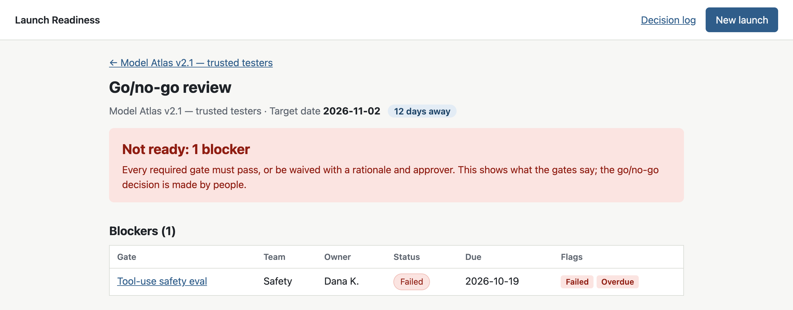
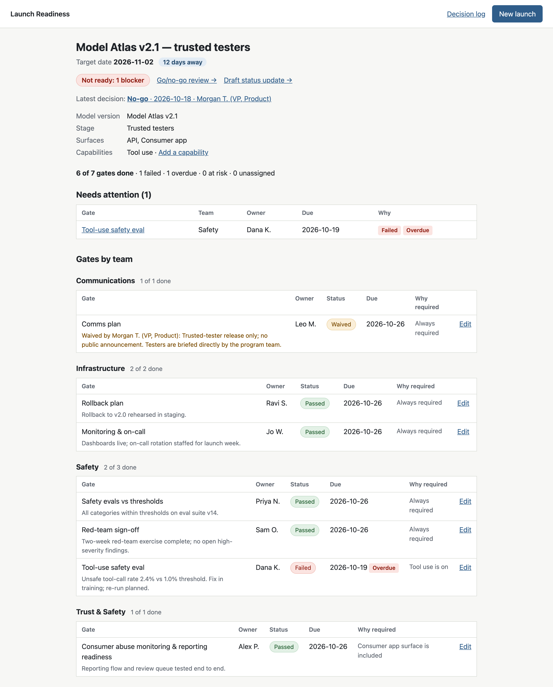
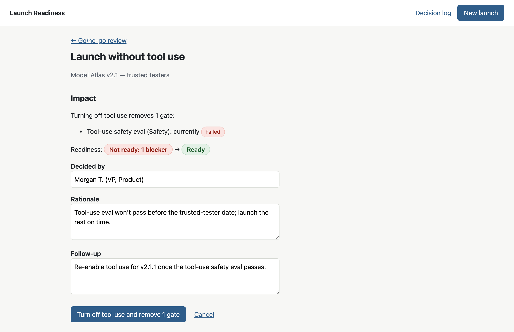
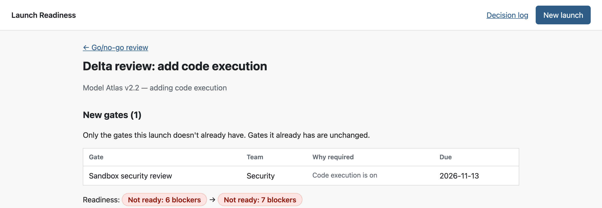
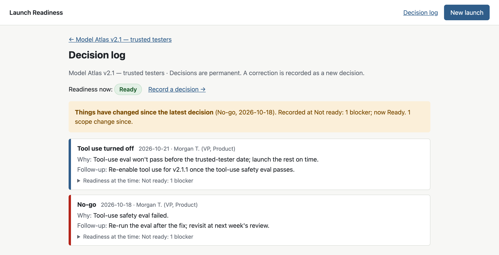

# Launch Readiness Tracker

**Go/no-go readiness for AI model releases, decided per launch configuration.**

An AI model release isn't one launch. The same model can ship to the API but not the consumer app, with tool use on but code execution off, to trusted testers before general availability. Each combination carries different risks and needs different sign-offs. Product-level checklists miss this: turning on code execution should trigger a sandbox security review, and a spreadsheet won't do that for you.

This tool takes a launch configuration (model version, surfaces, capabilities, rollout stage) and:

- **works out the required gates** from a rules file a non-engineer can edit
- **tracks each gate:** owner, status, due date, and failed, overdue or at-risk flags
- **shows Ready or Not ready** with the exact blockers. The go/no-go call stays with people.
- **lets you launch without a capability.** Its gates come off, readiness updates, and the scope change is logged with a follow-up.
- **shows only the new gates** when a capability is added (a delta review)
- **keeps a permanent decision log,** with what the gates said at the moment of each decision
- **drafts a leadership status update with Claude,** for a person to review. The AI never changes a gate or makes the call. *(Not yet tested against the real Claude API; see [Running it](#running-it).)*

*All model names, teams and people are fictional sample data.*



---

## Screenshots

**Launch dashboard.** Countdown to launch, a readiness badge, a *Needs attention* list, and gates grouped by team. The comms gate shows who approved its waiver and why.



**Launching without a capability.** Before confirming, you see exactly which gates come off and what readiness becomes: here, turning off tool use removes the failed eval and the launch goes from *Not ready* to *Ready*. A rationale and a follow-up are required.



**Delta review.** Adding code execution to Model Atlas v2.2 shows only the one new gate it needs (the sandbox security review), not the seven the launch already has.



**Decision log.** Every Go, No-go and scope change, newest first, each with a snapshot of readiness at the time. A notice flags when things have changed since the latest decision.



---

## Key design decisions

| Decision | Why |
|---|---|
| **Readiness is decided per configuration, not per product.** | Risk comes from what's turned on and where it ships. The same model needs different gates for "API, trusted testers" and "consumer app, GA, with code execution". |
| **Gate rules live in one YAML file, checked when it loads.** | Policy owners can change rules without touching code, and a typo (`code_exec`) fails loudly instead of silently skipping a gate. |
| **The app says *Ready* or *Not ready*; only people record *Go* or *No-go*.** | The tool informs the call; it doesn't make it. Keeping the words separate makes it obvious which is which. |
| **Go with open blockers is allowed, but never silently.** | Leaders sometimes accept a risk the gates don't capture. It needs an explicit acknowledgement and a follow-up, and it's marked "Go with open blockers" in the log. |
| **A waiver needs a rationale and a named approver.** | A waived gate counts as done, so it needs the same accountability as a pass. Enforced by the database as well as the form. |
| **Descoping is built in.** | Turning a capability off removes only gates nothing else needs, keeps them visible under *Removed by scope change*, and logs why. Turning it back on restores them as *not started*, with a note of their previous status, because an old pass may not hold for a new build. |
| **Decisions are permanent.** | The database refuses edits and deletions; a correction is a new decision. Each decision stores a readiness snapshot, so a stale "Go" is easy to spot. |
| **AI drafts, people decide.** | The summary reads launch data read-only and has no tools. Its output is only displayed. The page shows readiness from the app, never from the AI. The app works fully without an API key, and a declined request isn't retried on another model. |

---

## Running it

Requires Python 3.10+.

```bash
python3 -m venv .venv
source .venv/bin/activate
pip install -r requirements.txt

flask --app launch_readiness.app seed              # load the two sample launches
flask --app launch_readiness.app run --port 5001   # macOS uses port 5000 for AirPlay
```

Open http://127.0.0.1:5001. Run `seed` again at any time to reset the sample data.

**Tests:** `pytest`

**AI status summary (optional).** Set an API key before starting the app:

```bash
export ANTHROPIC_API_KEY=your-key
```

Without a key, the summary page says it isn't configured and everything else works as normal. The model (`claude-opus-5-5`) and effort level are in `launch_readiness/settings.py`.

> **Not yet tested against the real Claude API.** The AI summary has only been tested with a stand-in client. To verify it, set `ANTHROPIC_API_KEY` and run `RUN_LIVE_AI_TESTS=1 pytest tests/test_ai_live.py`, then generate one draft in the app.

**Screenshots** are generated by a script, so they can be refreshed after any UI change:

```bash
pip install -r requirements-dev.txt
playwright install chromium
python scripts/screenshots.py      # uses a temporary database; yours is untouched
```

---

## How it was built

I set the direction and made the product decisions, using Claude as a planning and review partner and Claude Code to write the code. I reviewed and approved each feature's plan, and the tests ran for every feature.

**Process.** The v1 scope is in [PLAN.md](PLAN.md). Each of the seven features followed the same loop, on its own branch:

1. **Plan:** a written proposal of the design and the tests, with open questions.
2. **Review:** decisions made and changes requested before any code was written.
3. **Build:** code and tests written to the approved plan.
4. **Verify:** the full test suite passed, and the feature was tried in the browser.
5. **Merge** into `main`.

**Key changes made in review**

- Verdict wording changed to *Ready / Not ready*, with *Go / No-go* reserved for the human decision.
- Waivers require a named approver as well as a rationale.
- Go with open blockers requires a follow-up, just like No-go.
- Gates are due 7 days before the target date (a named setting), so they finish before the go/no-go review rather than on launch day.
- A *Needs attention* list and *at risk* flags (not started and due within 3 days) were added to the dashboard.
- Restored gates come back as *not started*, with a note recording their previous status and any waiver.
- Removed gates stay visible on the dashboard with their last status and follow-up.
- No silent fallback to another model for the AI summary: if it declines, the page says so.
- Stage promotion was held back to a later feature to keep v1's scope tight.

**Tests.** 414 automated tests cover the gate rules, readiness, scope changes, the delta review, decisions and the AI summary (using a stand-in for the Claude API), plus one opt-in test against the real API. After each feature, bugs were introduced on purpose to confirm the tests catch them.

**Project layout**

| Path | What's there |
|---|---|
| `launch_readiness/gate_rules.yaml` | The gate rules |
| `launch_readiness/rules_engine.py` | Configuration → required gates, and the difference between two configurations |
| `launch_readiness/readiness.py` | The Ready / Not ready verdict and blockers |
| `launch_readiness/scope_change.py` | Turning capabilities off and on |
| `launch_readiness/decisions.py` | Go / No-go decisions and the decision log |
| `launch_readiness/ai_summary.py` | The only code that talks to Claude |
| `tests/` | The test suite |

---

## Limits and what's next

- **v1 is local-only:** SQLite, a single user, no logins or permissions, no integrations (Jira, Slack), and no protection against forged form submissions from other websites. All of these would be needed before deploying it.
- **Next:** stage promotion, where moving a launch to a later stage shows only the new gates it needs (e.g. trusted testers → limited GA adds capacity sign-off and legal review).
- **The AI summary hasn't been run against the real Claude API yet** (see above).

---

Built by Mariah Coleno · [LinkedIn](https://www.linkedin.com/in/mariah-coleno)
